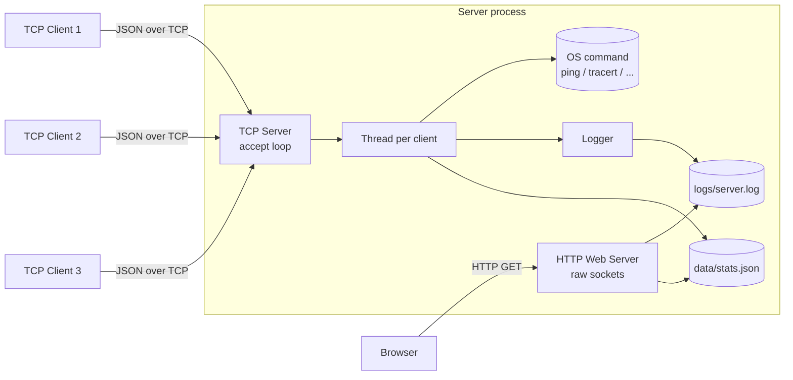

# Network Diagnostic System

A client–server application written in **pure Python (standard library only)** that lets remote clients run network diagnostic commands on a server, and lets you watch everything happen through a **hand-built HTTP web interface**.

Built for **ENCS3320 – Computer Networks** (Birzeit University) as a socket-programming project.


---

## Table of contents

- [What it does](#what-it-does)
- [Features](#features)
- [How it works](#how-it-works)
- [Project structure](#project-structure)
- [Getting started](#getting-started)
- [Configuration](#configuration)
- [Supported commands](#supported-commands)
- [Web interface](#web-interface)
- [Screenshots](#screenshots)
- [Testing](#testing)
- [Design decisions](#design-decisions)
- [Limitations](#limitations)
- [Team](#team)

---

## What it does

1. A **TCP client** shows a menu (ping, traceroute, DNS lookup, …) and sends the chosen request to the server.
2. A **multi-threaded TCP server** runs the matching operating-system command, measures how long it took, logs the request, and sends the result back.
3. An **HTTP web server**, written directly on top of sockets (no `http.server`, no frameworks), shows the history, statistics and live dashboard in a browser.

## Features

- **Multi-threaded TCP server** – one dedicated thread per client; the main thread only accepts connections, so many clients are served at the same time.
- **Seven diagnostic commands** – ping, traceroute, DNS lookup, IP configuration, routing table, ARP table, active TCP connections.
- **Automatic request logging** – timestamp, client IP/port, command, parameters, execution time and status, written with a lock so threads never corrupt the file.
- **Raw-socket HTTP server** with six pages: Home, Dashboard, Command History, Statistics, Search, Download Log.
- **Correct HTTP status codes** – `200 OK`, `400 Bad Request`, `403 Forbidden`, `404 Not Found` (with a custom error page).
- **Config-driven** – one JSON file; both ports are derived from the student ID (last three digits + 5000 / + 6000).
- **Defensive by design** – hostname validation (no option injection), HTML escaping of all log data, atomic stats-file writes, and a server that survives broken requests and dropped clients.
- **Standard library only** – `socket`, `threading`, `subprocess`, `os`, `time`, `datetime`, `json`, `pathlib`.

## How it works



**TCP protocol** – one JSON object per line (`\n` marks the end of a message):

```jsonc
// client -> server
{"command": "PING", "parameter": "google.com"}

// server -> client
{"command": "PING", "parameter": "google.com", "status": "Success",
 "output": "Pinging google.com ...", "execution_time": 3.08,
 "timestamp": "2026-08-25 15:42:37"}
```

**Log format** – one line per request:

```
Timestamp=2026-08-25 15:42:37 | ClientIP=127.0.0.1 | ClientPort=63693 | Command=PING | Parameters=google.com | ExecutionTime=3.0840 | Status=Success
```

## Project structure

```
network-diagnostic-system/
├── run_server.py            # starts the TCP server + HTTP web server
├── run_client.py            # starts one TCP client
├── config/
│   ├── config.json          # all settings
│   └── config_manager.py    # loads/validates config, computes the ports
├── core/
│   ├── logger.py            # thread-safe request logger
│   ├── log_parser.py        # log file -> Python dictionaries
│   ├── stats_calculator.py  # most used command, averages, success/fail counts
│   └── console.py           # thread-safe console messages
├── server/
│   └── tcp_server.py        # multi-threaded TCP server + command execution
├── client/
│   └── tcp_client.py        # interactive menu client
├── web/
│   ├── http_server.py       # raw-socket HTTP server, request parsing, routing
│   ├── pages.py             # HTML generation
│   ├── log_utils.py         # reading and searching the log
│   ├── stats_utils.py       # live dashboard numbers, uptime formatting
│   └── config_loader.py     # web-side view of the configuration
├── tests/                   # unit tests (unittest)
├── logs/                    # server.log is created here at runtime
├── data/                    # stats.json is created here at runtime
└── screenshots/             # demo screenshots
```

## Getting started

**Requirements:** Python 3.8 or newer. Nothing to install.

```bash
# 1. get the code
git clone https://github.com/htoonhmouz123/network-diagnostic-system.git
cd network-diagnostic-system

# 2. terminal 1 – start both servers (keep it open)
python run_server.py
#   [TCP] The Server is Ready to Receive on port 5706
#   [HTTP] Web server listening on port 6706 ...

# 3. terminal 2 (and 3, 4, ...) – start as many clients as you like
python run_client.py

# 4. open the web interface
#   http://localhost:6706/
```

Use `python3` instead of `python` on Linux/macOS.

## Configuration

Everything lives in [`config/config.json`](config/config.json):

| Key | Meaning | Default |
|---|---|---|
| `Student ID` | Digits only. **Ports are derived from its last 3 digits** | – |
| `TCP Port` / `HTTP Port` | Leave `null` – calculated as `last3 + 5000` / `last3 + 6000` | – |
| `Server Host` | Address the client connects to | `localhost` |
| `Log File` | Where requests are logged | `logs/server.log` |
| `Stats File` | Live numbers for the dashboard | `data/stats.json` |
| `MAX Clients` | Listen backlog of both servers | `10` |
| `Default Homepage` | Page shown for `/` | `/` (→ `/home`) |
| `Team` | Team name/members shown on the Home page | – |

Example: Student ID ending in `706` → TCP port **5706**, HTTP port **6706**.

## Supported commands

| Menu | Command | Windows | Linux |
|---|---|---|---|
| 1 | `PING <host>` | `ping -n 4` | `ping -c 4` |
| 2 | `TRACEROUTE <host>` | `tracert -d -h 15 -w 1000` | `traceroute -n -m 15` |
| 3 | `DNS <host>` | `nslookup` | `nslookup` |
| 4 | `IP_CONFIG` | `ipconfig` | `ip addr` |
| 5 | `ROUTING_TABLE` | `route print` | `ip route` |
| 6 | `ARP_TABLE` | `arp -a` | `arp -a` |
| 7 | `TCP_CONNECTIONS` | `netstat -ano` | `ss -tun` |

A command that fails, times out (15 s, traceroute 30 s) or does not exist on the machine is reported as `Failure`; the server and the client keep running.

## Web interface

| URL | Page |
|---|---|
| `/` or `/home` | Team, course and project description |
| `/dashboard` | Executed commands, connected clients, last execution time, server uptime |
| `/history` | Every logged request in an HTML table |
| `/statistics` | Total, most used command, average time, successes, failures |
| `/search?command=&hostname=&client_ip=` | Filter the history |
| `/download` → `/download/log` | Download the complete log file |
| anything else | Custom `404` page (`/private/...` and `..` give `403`) |

> The **Dashboard** shows the *current server session* (it resets when the server restarts), while **Statistics** are calculated from the *whole log file*.

## Screenshots

| Server start | Client menu |
|:---:|:---:|
|  |  |

**Successful ping**


**Traceroute timeout – the client keeps working**


| Home | Dashboard |
|:---:|:---:|
|  |  |

| Statistics | Search by hostname |
|:---:|:---:|
|  |  |

| 404 Not Found | 403 Forbidden |
|:---:|:---:|
|  |  |

More in [`screenshots/`](screenshots/) (ping failure, client exit, command history, search by command, download page).

## Testing

```bash
python -m unittest discover -s tests -t . -v
```

The unit tests cover configuration and port calculation, the logger/parser round trip, statistics, search filters, hostname validation, URL decoding, HTTP request parsing/response building and HTML escaping.

Manual scenarios that were checked:

- 3 clients connected at the same time, each receiving only its own result
- valid host (`google.com`) and invalid host → both `Success` and `Failure` are logged
- a slow traceroute times out without disconnecting the client
- a client exits (option 8) while the others keep working
- `404` for unknown pages, `403` for `/private/...` and `..`, `400` for malformed requests and non-GET methods

## Design decisions

- **One thread per client** (instead of one big loop) so a slow command such as traceroute never blocks other clients.
- **Newline-delimited JSON** is a simple message boundary for TCP, which is a byte stream with no message limits of its own.
- **Lock around the log file and the statistics** because many threads write at the same time.
- **Atomic stats file** (write to a temp file, then `os.replace`) so the dashboard never reads half a file.
- **Hostname validation** – commands are started without a shell, but a hostname like `-t` would still be read by `ping` as an option, so only letters, digits and `. - _ :` are accepted.
- **HTML escaping** – log values are user input, so every value is escaped before it reaches a page.

## Limitations

- Developed and demonstrated on **Windows**; the Linux command mapping is included but less tested.
- The HTTP server supports `GET` only, one request per connection, and reads up to 4 KB per request.
- Meant for learning and local demos, not for exposure to the internet: there is no authentication or encryption.

## Team

**Team T033** – ENCS3320 Computer Networks, Birzeit University

- Hatoon Hmouz
- Tamara Abu Ajaj
- Mayar Shweiki

*This is an academic project; it is published here for portfolio purposes.*
